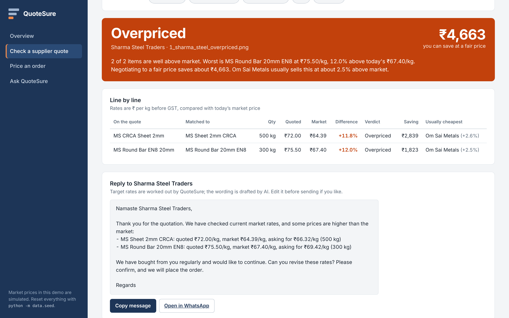
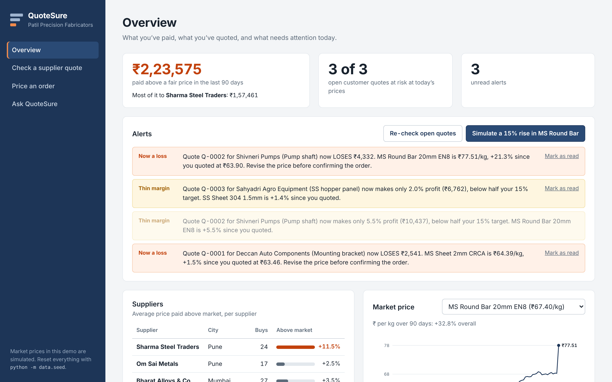
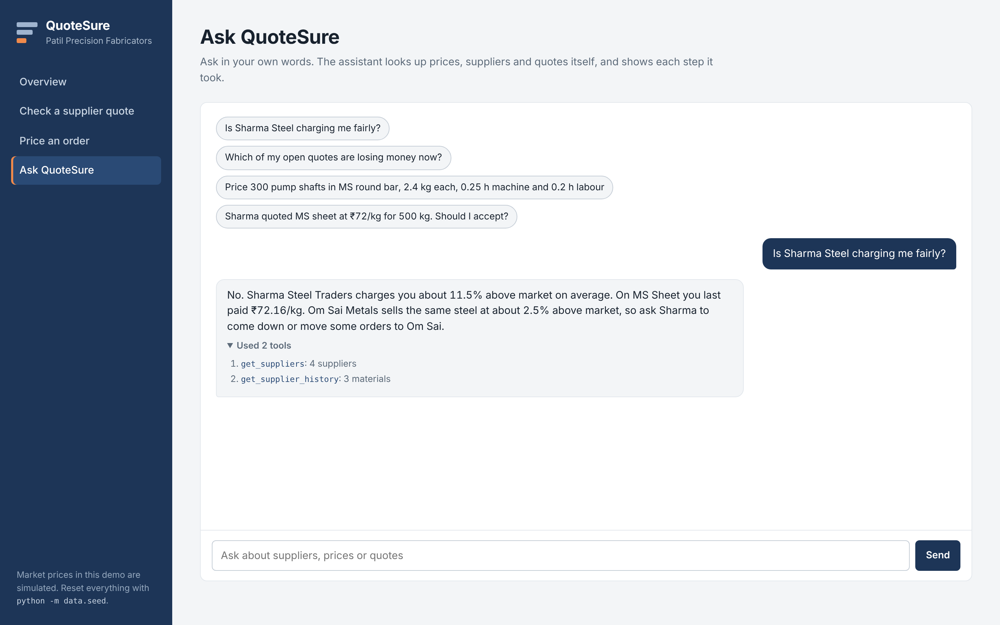
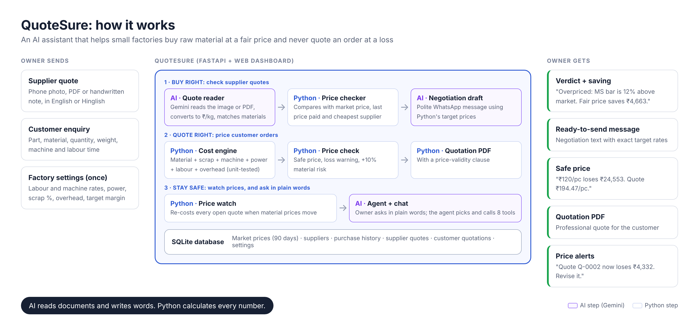

# QuoteSure

**An AI assistant that helps small factories buy raw material at a fair price and never quote an order at a loss.**

Built for the Industrial Manufacturing theme, problem statement **4.1: Small factories overpay for raw material and quote orders at a loss.**



---

## The problem

Most small factories (MSMEs) run purchasing and pricing from memory:

- They buy steel, aluminium or plastic from one or two familiar traders and have no quick way to tell whether a rate is fair.
- When a customer asks "how much for 500 pieces?", the owner estimates the cost and often misses scrap, power, machine time or a recent rise in material prices.

The result is paying too much for inputs and taking orders that quietly lose money.

## What QuoteSure does

### 1. Buy right: check any supplier quote
The owner uploads a photo or PDF of a supplier's quote, even a crooked phone photo of a handwritten note.

1. **Gemini reads it**: extracts each item, converts quantities to kg and prices to ₹/kg before GST (handles ₹/MT and Indian number formats like 1,16,000), and matches each item to a known material.
2. **Python checks it**: compares each rate with today's market price, what the factory last paid, and which supplier usually sells it cheapest.
3. **The owner gets a verdict** (overpriced / fair / good deal), the money saved at a fair price, and a polite WhatsApp message asking for the exact target rates.

> Example: *"Overpriced: MS Round Bar is ₹75.50/kg, 12.0% above today's ₹67.40/kg. Negotiating to a fair price saves about ₹4,663. Om Sai Metals usually sells this at about 2.5% above market."*

### 2. Quote right: price customer orders safely
The owner enters the part, material, quantity, weight and machine/labour time. The **cost engine** works out the true cost:

```
raw material per piece = finished weight ÷ (1 − scrap %)
material  = qty × raw kg × ₹/kg
machine   = qty × machine hours × (machine rate + power cost)
labour    = qty × labour hours × labour rate
overhead  = (material + machine + labour) × overhead %
TOTAL COST       = material + machine + labour + overhead
SAFE PRICE       = total cost × (1 + target margin %)
```

It flags a price that makes a loss, shows the effect of a 10% rise in material prices, and generates a professional quotation PDF with a price-validity clause.

> Example: *Quoting ₹120/piece for 500 MS brackets loses ₹24,553. Recommended price: ₹194.47/piece.*

### 3. Stay safe: watch prices
Every open quotation is re-costed at today's material price, so the owner is warned when a rise in steel prices turns a pending order into a loss.

> Example: *Quote Q-0002 for Shivneri Pumps now LOSES ₹4,332. MS Round Bar is ₹77.51/kg, +21.3% since you quoted. Revise the price before confirming the order.*

### 4. Ask QuoteSure: an AI agent
The owner asks in plain words (*"Is Sharma Steel charging me fairly?"*, *"Price 300 pump shafts…"*, *"Which open quotes are losing money?"*). A Gemini agent decides which of **8 tools** to call (market prices, supplier history, quote check, order estimate, open quotes, price watch, create quotation), runs them in a loop until it has the answer, and shows every step it took. It never calculates numbers itself: every figure comes from a tool.

## The dashboard

Everything above works from a web dashboard served by the backend itself, with no separate frontend build: **Overview** (money overpaid, quotes at risk, alerts, suppliers, price chart), **Check a supplier quote** (upload or one-click samples, verdict, line-by-line check, reply with *Open in WhatsApp*), **Price an order**, and **Ask QuoteSure**.







## Design principle: AI reads, Python calculates

Large language models can make arithmetic mistakes, and a wrong price costs a factory real money. So in QuoteSure:

- **Gemini** only reads documents and writes wording (the negotiation message).
- **Plain Python** calculates every number, and the cost engine is covered by unit tests.
- Gemini's output is forced into a fixed JSON schema and checked before use. If Gemini is unavailable, quotes can be entered by hand and the negotiation message falls back to a template.

## Tech stack

| Layer | Technology |
|---|---|
| Backend API | Python, FastAPI, Uvicorn |
| Database | SQLite with SQLAlchemy ORM |
| Validation | Pydantic |
| AI | Google Gemini (`google-genai`): vision for reading quotes, structured JSON output |
| PDF | ReportLab |
| Tests | pytest |
| Agent | Gemini function calling with a custom tool loop (8 tools) |
| Dashboard | Plain HTML, CSS and JavaScript served by FastAPI (no build step) |

## Run it locally

Requirements: Python 3.11+ and a free [Gemini API key](https://aistudio.google.com).

```bash
git clone https://github.com/<your-username>/quotesure.git
cd quotesure
cp .env.example .env          # then paste your Gemini key into .env

cd backend
python3 -m venv venv
source venv/bin/activate      # Windows: venv\Scripts\activate
pip install -r requirements.txt

python -m data.seed           # demo factory, 90 days of prices, suppliers, purchases
pytest -v                     # 11 tests
uvicorn app.main:app --reload
```

Open **http://127.0.0.1:8000** for the dashboard, or **http://127.0.0.1:8000/docs** to try every API endpoint.

**Demo in 2 minutes:**
1. *Check a supplier quote* → click **Typed quote** or **Handwritten photo**: Sharma's quote comes back *Overpriced*, with the saving and a reply ready for WhatsApp.
2. *Price an order* → **Work out the cost** with the pre-filled order: ₹120/piece loses ₹24,553; the safe price is ₹194.47.
3. *Overview* → **Simulate a 15% rise in MS Round Bar**: a new alert shows the Shivneri Pumps quote has turned into a loss.
4. *Ask QuoteSure* → *"Is Sharma Steel charging me fairly?"* and open **Used N tools** to see how the agent worked it out.

Run `python -m data.seed` to reset the demo data afterwards.

**Or through the API:** `POST /buying/check-quote` with any file from `backend/data/sample_quotes/`, or `POST /quotes/estimate` with:
```json
{"material_id": 1, "quantity": 500, "weight_per_piece_kg": 1.2,
 "machine_hours_per_piece": 0.1, "labour_hours_per_piece": 0.1,
 "owner_price_per_piece": 120}
```

If Gemini doesn't respond, run `python -m data.check_gemini` to test the connection step by step.

## API overview

| Endpoint | What it does |
|---|---|
| `POST /buying/check-quote` | Upload a supplier quote (image/PDF): AI reads it, prices are checked, negotiation message drafted |
| `POST /buying/check-items` | Same check with items typed in (no AI needed) |
| `GET /buying/quotes` | Supplier quotes checked so far |
| `POST /quotes/estimate` | True cost, safe price and loss check for an order (nothing saved) |
| `POST /quotes` | Save a customer quotation |
| `GET /quotes` | Customer quotations, each re-costed at today's material price |
| `GET /quotes/{id}/pdf` | Download a quotation PDF |
| `GET /materials` | Materials with today's price and 30-day change |
| `GET /materials/{id}/prices` | Price history for charts |
| `GET /suppliers` | Suppliers with the average % paid above market |
| `GET /suppliers/{id}` | One supplier's purchase history, with markup per purchase |
| `GET`/`PUT /settings` | The factory's cost rates |
| `POST /agent/chat` | Ask the AI agent; returns its reply and every tool call it made |
| `GET /alerts`, `POST /alerts/check` | Price-watch alerts; re-cost every open quotation now |
| `POST /materials/{id}/simulate-spike` | Demo: raise a material's price and run the price watch |
| `GET /dashboard` | Headline numbers for the overview screen |

## Demo data

`python -m data.seed` creates **Patil Precision Fabricators**, a small fabrication unit in Pune, with 6 materials, 90 days of simulated market prices, 4 suppliers, 76 past purchases and 3 open customer quotations.

The data hides a realistic story: the owner's long-time supplier, Sharma Steel Traders, has been charging about **11.5% above market**, while Om Sai Metals sells the same steel at about 2.5% above. QuoteSure surfaces this in seconds.

`backend/data/sample_quotes/` has 5 test quotes: typed, PDF, priced per tonne, and a handwritten phone photo.

> Market prices in the demo are simulated. In production they would come from market price feeds.

## Project structure

```
backend/
├── app/
│   ├── main.py              app entry point
│   ├── models.py            database tables
│   ├── schemas.py           API request/response shapes
│   ├── routers/             API endpoints (buying, quoting, alerts, agent, prices, suppliers, settings)
│   ├── agent/               the AI agent: tools.py, prompts.py, runner.py (the tool loop)
│   ├── static/              the web dashboard (index.html, styles.css, app.js)
│   └── services/
│       ├── extractor.py     Gemini reads supplier quotes
│       ├── quote_checker.py compares quotes with market and history
│       ├── negotiation.py   drafts the WhatsApp message
│       ├── cost_engine.py   true cost and safe price (pure math)
│       ├── alerts.py        price watch over open quotations
│       ├── price_service.py price lookups
│       └── pdf_service.py   quotation PDFs
├── data/                    seed data, sample quotes, Gemini check script
└── tests/                   pytest unit tests
docs/                        architecture diagram
```

## Roadmap

- **WhatsApp integration**: forward a supplier quote on WhatsApp and get the verdict back in the same chat
- **Live market prices**: connect real metal and polymer price feeds in place of the simulated ones
- **Voice in Hindi and Marathi**: ask the agent by voice from the shop floor
- **Group buying**: nearby small factories pool orders for bulk rates
